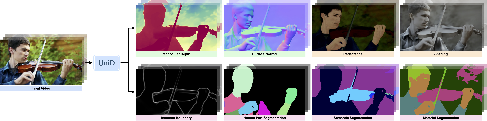

# Unified Video Dense Prediction from Disjoint Data

### [Project Page](https://unid-video.github.io/) | [Paper](https://arxiv.org/abs/2607.21592)

Official PyTorch implementation for the ECCV 2026 paper: "Unified Video Dense Prediction from Disjoint Data".



## Inference

### Requirements

Inference is supported on CUDA GPUs. The Phase 1 baseline used Python 3.10, PyTorch 2.2.0, torchvision 0.17.0, CUDA 12.1, xFormers 0.0.24, and an NVIDIA RTX A6000. The model enables xFormers memory efficient attention unconditionally. CPU inference is not supported by this release.

Create and activate a Python 3.10 environment with a CUDA-compatible PyTorch installation, then install the tested inference dependencies and package:

```bash
python -m pip install -r requirements.txt
```

Alternatively, `bash scripts/setup.sh` runs those commands in the active environment. The pinned file records the tested stack; other CUDA/PyTorch combinations are not validated by this release check.

CRF refinement is optional. Install `pydensecrf` separately to use `--post_crf`; otherwise leave that flag off. The single requirements file also installs research dependencies; training and evaluation remain optional workflows.

### Model checkpoints

Download model checkpoints here: [link](https://drive.google.com/file/d/1tvUpgVSWo0aTNKWifzOZQ7BdzqYMd5EA/view?usp=sharing)

Expected checkpoints layout:

```text
checkpoints/
├── unid_b32_T4_80k/
│   ├── arguments.txt
│   ├── model_index.json
│   ├── unet/{config.json,diffusion_pytorch_model.safetensors}
│   ├── connectors/                 # present for unified checkpoints
│   │   └── <task>.bin
│   └── projectors/
│       └── <projector>.bin
│
└── pretrained_sd2/
    ├── model_index.json
    ├── scheduler/scheduler_config.json
    ├── text_encoder/{config.json,model.safetensors}
    ├── tokenizer/{tokenizer_config.json,vocab.json,merges.txt,...}
    ├── unet/{config.json,diffusion_pytorch_model.safetensors}
    └── vae/{config.json,diffusion_pytorch_model.safetensors}
```

The documented and GPU-verified checkpoint variant is `unid_b32_T4_80k`. Other compatible checkpoints can be passed by local path if they include the training `arguments.txt`, UNet, projectors, and configured connectors; they have not been verified in this release check. Existing checkpoint directory names remain usable. Use `--base_model` when the base snapshot is not at `checkpoints/pretrained_sd2`.

### Run an image or frame directory

From the repository root, run one image:

```bash
python Unid/run.py \
  --checkpoint checkpoints/unid_b32_T4_80k \
  --base_model checkpoints/pretrained_sd2 \
  --input_rgb assets/example/00000.jpg \
  --projs depth \
  --output_dir vis/example_image
```

Run a video as a directory of frames. Supported files are read non-recursively in sorted filename order:

```bash
python Unid/run.py \
  --checkpoint checkpoints/unid_b32_T4_80k \
  --base_model checkpoints/pretrained_sd2 \
  --input_rgb assets/example \
  --projs depth normal albedo illum boundary partseg-coco matseg semseg-coco semseg-cityscapes semseg-vipseg restore \
  --early_break 3 \
  --post_crf \
  --output_dir vis/example_video
```

Inputs may be `.jpg`, `.jpeg`, or `.png`; decode a video file into frames first. The command checks both model directories and reports missing required files before model loading.

### Batched visualization

Place your local visualization frames under `data/supp_vis/imgs` (or the matching path under `UNID_DATA_ROOT`) and run the following:
```bash
python Unid/run_batch.py --ckpt_path <CKPT_PATH> --video_dir <VID_DIR> --output_dir <OUT_DIR> --gpu_ids <DEVICE_IDS> -- [optional tags]

## example
python Unid/run_batch.py --ckpt_path checkpoints/unid_b32_T4_80k --video_dir data/supp_vis/imgs --output_dir vis/ --gpu_ids 0 1 2 3 -- --post_crf
```

### Tasks, temporal settings, and outputs

The verified checkpoint provides `depth`, `normal`, `albedo`, `illum`, `boundary`, `partseg-coco`, `matseg`, `semseg-coco`, `semseg-cityscapes`, `semseg-vipseg`, and `restore`. The examples select `depth` so they run without benchmark datasets. By default, all available projectors are used; selecting `matseg` (or using the default set) also requires the `taxonomy.json` metadata from a locally obtained DMS release at `data/DMS_v1/taxonomy.json` to colorize material predictions. Select a subset with `--projs depth normal semseg-coco`.

The default temporal settings are `--model_params '(len=16,st=1,pop_loc=0)'`: memory length 16, temporal stride 1, and queue pop location 0. `--stride N` skips input frames before inference; `--early_break N` limits a run to its first N frames.

By default, the longest image edge is resized to at most 768 pixels for processing, and maps are resized back to input dimensions. Set `--processing_res 0` to process at input resolution. `--output_processing_res` keeps output maps at the processing size. Inference uses float32 by default; `--half_precision` enables float16 and may change predictions. Other behavior-affecting options include `--noise {zeros,gaussian,pyramid}`, `--seed`, `--text_prompt`, `--timestep_spacing {trailing,leading}`, and `--resample_method {bilinear,bicubic,nearest}`.

Each projector writes a colored PNG under `<output_dir>/<projector>/`. Depth arrays are also saved under `<output_dir>/_depth_npy/`; `--store_np` saves arrays for every selected projector. Depth coloring uses the min and max across all processed frames in a directory run. Segmentation and material predictions are saved as colorized class maps; normals, albedo, illumination, and restoration outputs are rendered as RGB images. `--post_crf` refines segmentation/material probabilities and requires optional `pydensecrf`.

The Phase 1 record and supplied release plan retain pre-rename paths as historical references. `UNIP:` comments in the bundled DSINE adapter are upstream integration annotations.

## Optional workflows

Note: Due to cost, the repository does not host the training and benchmark datasets. Please obtain each dataset from its upstream source, follow its access and license terms, and provide a local layout. For the included dataset loaders and evaluation launchers, set `UNID_DATA_ROOT` to the directory containing the local dataset folders (default: `data/`). Training also needs generated local Parquet indexes; set `UNID_INDEX_ROOT` to store them separately. See [DATA_PREPARATION.md](DATA_PREPARATION.md) for dataset sources, expected layouts, index commands, and evaluation split manifests.

The unified `requirements.txt` installs the evaluation and training packages plus the project’s public `panopticapi` and `utils3d` source dependencies. These workflows may require additional system tools and model checkpoints. Training configs default to W&B logging; configure W&B credentials or update `report_to` to a tracker available in your environment. No service login is part of inference setup.

Evaluation shell launchers accept the same `UNID_DATA_ROOT` setting and check the required local dataset roots before running. For example:

```bash
export UNID_DATA_ROOT=/datasets/unid
bash experiments/quant.sh D checkpoints/unid_b32_T4_80k
```

The directory must contain the dataset trees required by that task, such as `marigold_eval/` and `video_depth_data/` for depth evaluation. A missing dataset reports the path to provide. Benchmark commands can produce different results if inputs, annotations, or checkpoint variants differ from the published evaluation setup.

These scripts preserve the metric definitions and runners, but the repository alone does not reproduce the published training runs or benchmark scores. Results require the matching checkpoint, authorized dataset version, annotations, and preprocessing. The project does not redistribute those datasets.

### Training

Training proceeds in three stages: specialist training, unified distillation, and (optionally) task-specific fine-tuning.

Training requires the local Stable Diffusion 2 base model configured in `training/configs/pretrained_models.yaml` and the local dataset trees and Parquet indexes described above. Unified distillation also needs the specialist checkpoints referenced by `training/configs/s1_unified.yaml`; fine-tuning needs the unified checkpoint selected in its command. Update those config paths for your artifacts. Multi-node training requires an external Accelerate/distributed setup. Training configs default to W&B logging; install the optional research dependencies and configure credentials when using that tracker.

### Stage 1 — 🎓 Specialist Training

🔹 Train a dedicated specialist for each task:

```bash
bash training/scripts/run_single_node.sh training/s0_specialist.py training/configs/s0_specialist.yaml --overwrite task_to_train={TASK_NAME} [...]
```

<details>
<summary>Per-task commands</summary>

```bash
bash training/scripts/run_single_node.sh training/s0_specialist.py training/configs/s0_specialist.yaml --overwrite task_to_train=depth
bash training/scripts/run_single_node.sh training/s0_specialist.py training/configs/s0_specialist.yaml --overwrite task_to_train=normal
bash training/scripts/run_single_node.sh training/s0_specialist.py training/configs/s0_specialist.yaml --overwrite task_to_train=albedo
bash training/scripts/run_single_node.sh training/s0_specialist.py training/configs/s0_specialist.yaml --overwrite task_to_train=illum
bash training/scripts/run_single_node.sh training/s0_specialist.py training/configs/s0_specialist.yaml --overwrite task_to_train=boundary
bash training/scripts/run_single_node.sh training/s0_specialist.py training/configs/s0_specialist.yaml --overwrite task_to_train=partseg
bash training/scripts/run_single_node.sh training/s0_specialist.py training/configs/s0_specialist.yaml --overwrite task_to_train=matseg max_train_steps=80000
bash training/scripts/run_single_node.sh training/s0_specialist.py training/configs/s0_specialist.yaml --overwrite task_to_train=semseg max_train_steps=80000
```

</details>

- 💾 Specialist checkpoints: `checkpoints/sd2_specialist_{TASK}_{*}/`.

### Stage 2 — 🔗 Unified Training

🔹 Distill all specialists into a single unified backbone:

```bash
bash training/scripts/run_multi_node.sh training/s1_unified.py training/configs/s1_unified.yaml [--pods 0 1 ...]
```

- 💾 Distillation checkpoints: `checkpoints/sd2_unified_{*}/`
- 💾 Final merged checkpoint: `checkpoints/sd2_unified_{*}_combined/`

### Stage 3 — 🔧 Task-Specific Fine-tuning (Optional)

🔹 Fine-tune only the connectors and projectors while keeping the unified backbone frozen:

```bash
bash training/scripts/run_single_node.sh training/s2_finetune.py training/configs/s2_finetune.yaml --overwrite model_to_finetune=checkpoints/sd2_unified_{*}_combined task_to_finetune=partseg
bash training/scripts/run_single_node.sh training/s2_finetune.py training/configs/s2_finetune.yaml --overwrite model_to_finetune=checkpoints/sd2_unified_{*}_combined task_to_finetune=matseg
bash training/scripts/run_single_node.sh training/s2_finetune.py training/configs/s2_finetune.yaml --overwrite model_to_finetune=checkpoints/sd2_unified_{*}_combined task_to_finetune=semseg
```

Fine-tuned weights are saved under:
- 💾 `checkpoints/sd2_ft_unified_{*}_combined/connectors/`
- 💾 `checkpoints/sd2_ft_unified_{*}_combined/projectors/`

---

### Evaluation

#### 🗂️ Task-Specific Evaluation

All per-task quantitative evaluations are run via:

```bash
bash experiments/quant.sh {TASKS} {CKPT_PATH} {INF_PARAMS}
```

> **Default inference params** (used when `{INF_PARAMS}` is omitted): `"(len=16,st=1,pop_loc=0)"` — temporal memory length 16, stride 1, dequeue location 0.

<details>
<summary><strong>Depth</strong></summary>

```bash
bash experiments/quant.sh D checkpoints/sd2_specialist_D_T4_30k     # task-specialist
bash experiments/quant.sh D checkpoints/unid_b32_T4_80k             # unified model
```

Results: `quant/depth/{CKPT}/summary.txt` (per-frame), `quant/video_depth/{CKPT}{INF_PARAMS}/scannet_test/results.txt` (video)

</details>

<details>
<summary><strong>Surface Normals</strong></summary>

```bash
bash experiments/quant.sh N checkpoints/sd2_specialist_N_T4_30k     # task-specialist
bash experiments/quant.sh N checkpoints/unid_b32_T4_80k             # unified model
```

Results: `quant/normals/dsine/{CKPT}/summary.txt` (per-frame), `quant/video_normal/{CKPT}{INF_PARAMS}/summary.txt` (video)

</details>

<details>
<summary><strong>Albedo</strong></summary>

```bash
bash experiments/quant.sh A checkpoints/sd2_specialist_A_T4_30k     # task-specialist
bash experiments/quant.sh A checkpoints/unid_b32_T4_80k             # unified model
```

Results: `quant/albedo/{CKPT}/summary.txt` (per-frame), `quant/video_albedo/{CKPT}{INF_PARAMS}/summary.txt` (video)

</details>

<details>
<summary><strong>Shading (Illum)</strong></summary>

```bash
bash experiments/quant.sh I checkpoints/sd2_specialist_I_T4_30k     # task-specialist
bash experiments/quant.sh I checkpoints/unid_b32_T4_80k             # unified model
```

Results: `quant/illum/{CKPT}/summary.txt` (per-frame), `quant/video_illum/{CKPT}{INF_PARAMS}/summary.txt` (video)

</details>

<details>
<summary><strong>Instance Boundary</strong></summary>

```bash
bash experiments/quant.sh B checkpoints/sd2_specialist_B_T4_30k     # task-specialist
bash experiments/quant.sh B checkpoints/unid_b32_T4_80k             # unified model
```

Results: `quant/boundary/{CKPT}/summary_metrics.txt`

</details>

<details>
<summary><strong>Human Part Segmentation</strong></summary>

```bash
bash experiments/quant.sh P checkpoints/sd2_specialist_P_T4_30k     # task-specialist
bash experiments/quant.sh P checkpoints/unid_b32_T4_80k             # unified model
```

Results: `quant/partseg-coco/{CKPT}/summary.txt`

</details>

<details>
<summary><strong>Material Segmentation</strong></summary>

```bash
bash experiments/quant.sh M checkpoints/sd2_specialist_M_T4_80k     # task-specialist
bash experiments/quant.sh M checkpoints/unid_b32_T4_80k             # unified model
```

Results: `quant/matseg/{CKPT}/summary.txt`

</details>

<details>
<summary><strong>Semantic Segmentation</strong></summary>

```bash
bash experiments/quant.sh S checkpoints/sd2_specialist_S_T4_80k     # task-specialist
bash experiments/quant.sh S checkpoints/unid_b32_T4_80k             # unified model
```

Results: `quant/semseg/{CKPT}{INF_PARAMS}/summary.txt` (per-frame + video)

</details>

#### 🔄 Cross-Task Consistency Evaluation

All cross-task consistency evaluations are run via:
```bash
bash experiments/eval_scripts/cross_task_{depth_normal|partseg_semseg|albedo_illum}.sh {CKPT_PATH1} [Optional: {CKPT_PATH2}]
```

<details>
<summary><strong>Depth ↔ Normal</strong></summary>

```bash
bash experiments/eval_scripts/cross_task_depth_normal.sh checkpoints/sd2_specialist_D_T4_30k checkpoints/sd2_specialist_N_T4_30k    # two task-specialist
bash experiments/eval_scripts/cross_task_depth_normal.sh checkpoints/unid_b32_T4_80k    # unified model
```

Results: `quant/ctc/ctc_depth_normal/{CKPT}/ctc_dn_results.txt`
</details>

<details>
<summary><strong>Part Seg ↔ Sem. Seg</strong></summary>

```bash
bash experiments/eval_scripts/cross_task_partseg_semseg.sh checkpoints/sd2_specialist_P_T4_30k checkpoints/sd2_specialist_S_T4_80k    # two task-specialist
bash experiments/eval_scripts/cross_task_partseg_semseg.sh checkpoints/unid_b32_T4_80k    # unified model
```

Results: `quant/ctc/ctc_partseg_semseg/{CKPT}/ctc_ps_results.txt`
</details>

<details>
<summary><strong>Albedo ↔ Shading</strong></summary>

```bash
bash experiments/eval_scripts/cross_task_albedo_illum.sh checkpoints/sd2_specialist_A_T4_30k checkpoints/sd2_specialist_I_T4_30k    # two task-specialist
bash experiments/eval_scripts/cross_task_albedo_illum.sh checkpoints/unid_b32_T4_80k    # unified model
```

Results: `quant/ctc/ctc_albedo_illum/{CKPT}/ctc_ai_results.txt`
</details>


## Acknowledgments
UniD builds on the work of the open-source research community. We thank the authors
of [Marigold](https://github.com/prs-eth/Marigold), [DSINE](https://github.com/baegwangbin/DSINE),
[Depth Anything](https://github.com/LiheYoung/Depth-Anything), and
[StreamV2V](https://github.com/Jeff-LiangF/streamv2v). The bundled DSINE evaluation
code also includes components attributed in their source files to torchvision and
PyTorch3D. Please refer to the relevant source files and license notices for details.

## License
Unless otherwise stated, UniD-authored source code is licensed under
[CC BY-NC 4.0](https://creativecommons.org/licenses/by-nc/4.0/); see
[License.md](License.md). Third-party code and components retain their
respective licenses and notices. Pretrained models, checkpoints, and datasets
may be subject to separate terms and are not relicensed by this notice.
See the relevant component notices and [DATA_PREPARATION.md](DATA_PREPARATION.md)
for details.

## Citation
If you find our work useful in your research, please consider citing our paper:

```
@article{sun2026unid,
  title={Unified Video Dense Prediction from Disjoint Data},
  author={Yihong Sun and Oh, Seoung Wug and Jiahui Huang and Bharath Hariharan and Joon-Young Lee},
  booktitle={ECCV},
  year={2026}
}
```
